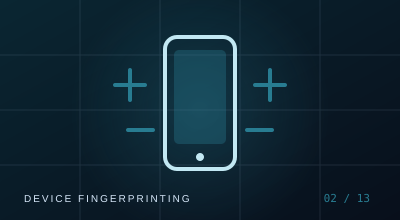
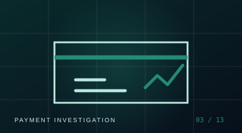
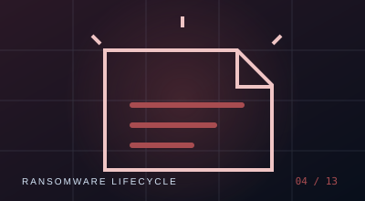
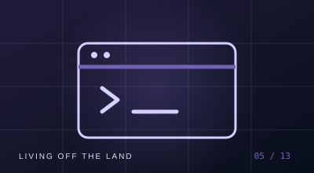
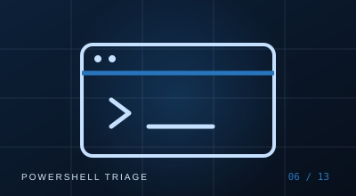
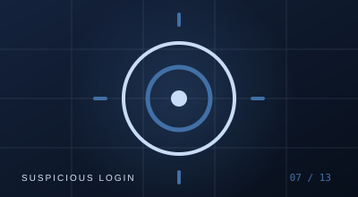

  <aside class="psv-journal-sidebar" aria-label="Journal categories">
    
EXPLORE

    <a class="psv-journal-side-link is-active" href="./">◈ All stories <small>01</small></a>
    <a class="psv-journal-side-link" href="cyber-fraud/">⌁ Cyber Fraud</a>
    <a class="psv-journal-side-link" href="threat-analysis/">⌖ Threat Analysis</a>
    <a class="psv-journal-side-link" href="soc-investigations/">⌘ SOC Investigations</a>
    <a class="psv-journal-side-link" href="vulnerabilities/">⛨ Vulnerabilities</a>
    <a class="psv-journal-side-link" href="lab-notes/">⌬ Lab Notes</a>
    <a class="psv-journal-side-link" href="security-explainers/">◇ Security Explainers</a>
  </aside>

  <section class="psv-journal-main">
    

THE LATEST
<h2>Featured story</h2>
01 PUBLISHED STORY

    <a class="psv-story-feature" href="cyber-fraud/account-takeover-explained/">
      
IDENTITY / SESSION / TRUST

◈
<b class="psv-ato-node psv-ato-node--one">01</b><b class="psv-ato-node psv-ato-node--two">02</b><b class="psv-ato-node psv-ato-node--three">03</b>ACCOUNT TAKEOVER · EXPLAINED

      
CYBER FRAUD <i>·</i> EXPLAINER<h3>How Does a Banking Account Takeover Actually Work?</h3>
From exposed credentials to stolen sessions, understand the common routes into a digital banking account—and the evidence investigators should connect before drawing conclusions.
Read the story <b>↗</b><small class="psv-story-date">31 OCT 2026 <i>·</i> 9 MIN READ</small>

    </a>

    

THE JOURNAL
<h2>Latest stories</h2>
13 ARTICLES · 6 CATEGORIES

    

<a class="psv-story-card" href="cyber-fraud/device-fingerprinting-in-banking/">
      

      
CYBER FRAUD <i>·</i> EXPLAINER<h3>Device Fingerprinting in Banking: What It Can—and Cannot—Prove</h3>
A practical guide to device signals, device binding, spoofing limits, and how fraud teams should interpret a device match.

<small>01 NOV 2026 <i>·</i> 8 MIN READ</small>Read story ↗

    </a>
<a class="psv-story-card" href="cyber-fraud/investigating-suspicious-bank-transfer/">
      

      
CYBER FRAUD <i>·</i> EXPLAINER<h3>Investigating a Suspicious Bank Transfer: Build the Timeline Before the Theory</h3>
Connect login, session, beneficiary, authentication, and payment evidence without jumping to conclusions.

<small>01 NOV 2026 <i>·</i> 9 MIN READ</small>Read story ↗

    </a>
<a class="psv-story-card" href="threat-analysis/ransomware-attack-chain/">
      

      
THREAT ANALYSIS <i>·</i> EXPLAINER<h3>A Ransomware Attack, Step by Step: What Happens Before Files Are Encrypted?</h3>
Understand common intrusion stages, where defenders can detect them, and why recovery starts before encryption.

<small>01 NOV 2026 <i>·</i> 10 MIN READ</small>Read story ↗

    </a>
<a class="psv-story-card" href="threat-analysis/living-off-the-land/">
      

      
THREAT ANALYSIS <i>·</i> EXPLAINER<h3>Living off the Land: Why Legitimate Tools Can Look Suspicious</h3>
How attackers abuse built-in utilities, why simple blocklists fail, and how to investigate behaviour and context.

<small>01 NOV 2026 <i>·</i> 8 MIN READ</small>Read story ↗

    </a>
<a class="psv-story-card" href="soc-investigations/investigating-suspicious-powershell/">
      

      
SOC INVESTIGATIONS <i>·</i> EXPLAINER<h3>How to Investigate Suspicious PowerShell Activity</h3>
A practical triage workflow using process lineage, Event 4104, Sysmon, network activity, and host context.

<small>01 NOV 2026 <i>·</i> 9 MIN READ</small>Read story ↗

    </a>
<a class="psv-story-card" href="soc-investigations/triaging-suspicious-login-alert/">
      

      
SOC INVESTIGATIONS <i>·</i> EXPLAINER<h3>Triage a Suspicious Login Alert Without Jumping to Conclusions</h3>
Separate failed attempts, successful authentication, session creation, and account activity while building a defensible timeline.

<small>01 NOV 2026 <i>·</i> 8 MIN READ</small>Read story ↗

    </a>
    

    <nav class="psv-journal-pagination" aria-label="Journal pages">1<a class="psv-page-link" href="page/2/">2</a>Page 1 of 2<a class="psv-page-next" href="page/2/">Older articles →</a></nav>
  
  </section>

