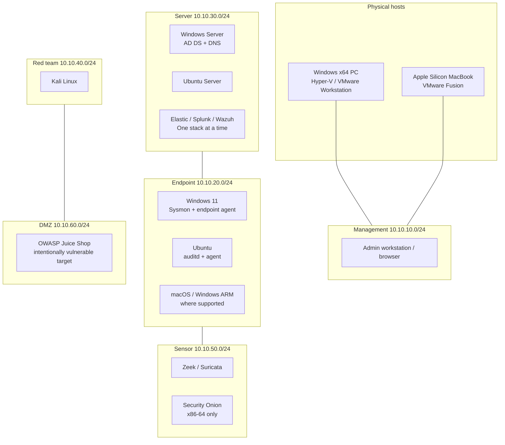

# Enterprise-style cybersecurity home lab

<badge color="warning">Build guide — not yet lab-tested</badge>

This programme builds a segmented, multi-OS cybersecurity environment using a Windows x64 PC and an Apple-silicon MacBook. It is split into independent labs so you can build and validate each platform and product without trying to run every stack simultaneously.

**Evidence rule:** these are reference build instructions. They are not claims that PSV has installed or tested the environment. Mark a lab **Lab-tested** only after recording host hardware, exact software versions, commands, observed results, evidence and cleanup.

## Target architecture

This is a logical design. It does not create network isolation by itself. Implement the segments and firewall rules in the hypervisor or dedicated lab router/firewall and test isolation before running any assessment.

## Build order

| Order | Lab | Outcome |
|---|---|---|
| 0 | [Hardware and compatibility](requirements.md) | Confirm which workloads fit each host |
| 1 | [Windows host setup](platform-windows.md) | Hypervisor, storage and virtual switches |
| 2 | [Mac Apple-silicon setup](platform-macos.md) | ARM virtualisation and supported guest images |
| 3 | [Network design](network-design.md) | Segments, routing, firewall policy and isolation tests |
| 4 | [Operating systems and identity](operating-systems.md) | Windows Server, Windows client, Ubuntu and Kali |
| 5 | [Elastic SIEM](elastic-siem.md) | Elasticsearch, Kibana, Fleet and endpoint telemetry |
| 6 | [Splunk SIEM](splunk-siem.md) | Splunk Enterprise and Universal Forwarder |
| 7 | [Wazuh SOC](wazuh-soc.md) | Manager, indexer, dashboard and agents |
| 8 | [Network monitoring](network-monitoring.md) | Zeek, Suricata and packet visibility |
| 9 | [Security Onion](security-onion.md) | Standalone x86-64 network security monitoring |
| 10 | [Penetration-testing lab](penetration-testing.md) | Kali, OWASP Juice Shop and isolated targets |
| 11 | [SOC validation exercises](soc-exercises.md) | Event generation, ingestion, detection and investigation |

Build and validate one SIEM at a time. Security Onion is a separate, resource-intensive platform; do not co-host it with all other stacks on a constrained PC.

## Platform allocation

### Windows x64 PC — primary host

Use this host for x86-64 Windows Server, Windows 11, Ubuntu, Splunk Enterprise, Security Onion and the primary SIEM labs. Security Onion requires x86-64 and its standalone deployment has a vendor bare minimum of 4 CPU cores, 24 GB RAM, 200 GB storage and 2 NICs.

### Apple-silicon MacBook — ARM64 host

Use ARM64 guest images for Ubuntu, Kali and Windows 11 ARM. Elastic and Wazuh components can run on supported ARM64 Linux releases; check each component's support matrix. Splunk Enterprise does not support ARM architecture. VMware Fusion on Apple Silicon does not run x86-64 guest operating systems.

Windows 11 ARM in Fusion has limitations including unavailable nested-virtualisation-dependent features such as WSL2 and VBS. Use a separate Linux VM for Docker-based vulnerable targets rather than relying on Docker Desktop inside this Windows ARM guest.

## Resource planning

These are home-lab starting allocations, not universal vendor minimums. Reserve at least 8–12 GB RAM for a Windows host with 64 GB RAM and leave additional headroom for hypervisor overhead.

| VM/service | vCPU | RAM | Disk |
|---|---:|---:|---:|
| Windows Server AD DS/DNS | 2–4 | 6–8 GB | 80 GB |
| Windows 11 endpoint | 2–4 | 6–8 GB | 80 GB |
| Ubuntu endpoint/server | 2 | 2–4 GB | 40–60 GB |
| Kali | 2–4 | 4–8 GB | 60–80 GB |
| Elastic single-node lab | 4–8 | 12–16 GB | 150–200 GB |
| Splunk Enterprise lab | 4 | 8–12 GB | 100–150 GB |
| Wazuh all-in-one (1–25 agents) | 4 | 8 GiB | 50 GB / 90 days indexed alerts |
| Security Onion Standalone | 4+ | 24–32 GB | 200+ GB, 2 NICs |
| OWASP Juice Shop target | 2 | 2–4 GB | 20 GB |

Do not allocate all host memory to VMs. Run Elastic, Splunk, Wazuh and Security Onion sequentially. The 64 GB Windows PC is the main SIEM and Security Onion host. A 16 GB MacBook is best limited to one small ARM Linux VM; 24–36 GB provides more flexibility.

## Network address plan

Use private RFC1918 ranges and check for overlap with your home LAN, work VPN, corporate routes or other local networks before configuring them.

| Segment | Subnet | Purpose |
|---|---|---|
| MGMT | 10.10.10.0/24 | Admin workstation and management interfaces |
| ENDPOINT | 10.10.20.0/24 | Windows, Linux and Mac endpoints |
| SERVER | 10.10.30.0/24 | AD DS/DNS and SIEM servers |
| REDTEAM | 10.10.40.0/24 | Kali and authorised assessment source |
| SENSOR | 10.10.50.0/24 | Passive capture and monitoring |
| DMZ | 10.10.60.0/24 | Intentionally vulnerable applications |

Suggested addresses: lab router/firewall .1 per subnet; domain controller 10.10.30.10; Elastic 10.10.30.20; Splunk 10.10.30.21; Wazuh 10.10.30.22; Kali 10.10.40.10; Juice Shop 10.10.60.20. Assign a gateway only when a router/firewall exists on that segment.

## Network security policy

Start with default-deny between segments. Allow only required management, DNS/NTP and telemetry flows. Kali may access only explicitly authorised target IPs/ports. Vulnerable targets must not be bridged to the home LAN. A sensor capture NIC should receive mirrored traffic and must not route or provide management access.

A virtual switch is Layer 2 connectivity, not a firewall. Hyper-V private switches and Fusion host-only networks do not automatically connect across the two physical hosts. Cross-host integration requires an explicit lab router/firewall or a separate telemetry path.

## Lab evidence standard

Each lab write-up should record:
1. Host CPU architecture, RAM and free SSD.
2. Hypervisor and version.
3. Guest OS edition/build/architecture and ISO checksum.
4. VM CPU/RAM/disk/NIC settings and snapshots.
5. Network segments, addresses, routes and firewall rules.
6. Product versions, licence mode and install method.
7. Verification commands, raw source events and SIEM copies.
8. Expected versus actual results, troubleshooting and cleanup.

Never publish real customer data, employer logs, internal IPs, production credentials or tokens.

## Official documentation

- [VMware Fusion and Workstation FAQ](https://www.vmware.com/docs/desktop-hypervisor-faqs)
- [Microsoft Hyper-V host requirements](https://learn.microsoft.com/en-us/windows-server/virtualization/hyper-v/host-hardware-requirements)
- [Microsoft Windows 11 ARM ISO](https://learn.microsoft.com/en-us/windows/arm/iso)
- [Kali official downloads and verification](https://www.kali.org/docs/introduction/download-official-kali-linux-images/)
- [Elastic self-managed installation](https://www.elastic.co/docs/deploy-manage/deploy/self-managed/tutorial-self-managed-install)
- [Splunk Enterprise system requirements](https://help.splunk.com/en/splunk-enterprise/administer/install-and-upgrade/10.6/plan-your-splunk-enterprise-installation/system-requirements-for-use-of-splunk-enterprise-on-premises)
- [Wazuh Quickstart](https://documentation.wazuh.com/current/quickstart.html)
- [Security Onion hardware requirements](https://docs.securityonion.net/en/3/dev/hardware/)

**Programme status:** documentation is under construction. No VM, SIEM or sensor is claimed to have been installed or tested by this page.
